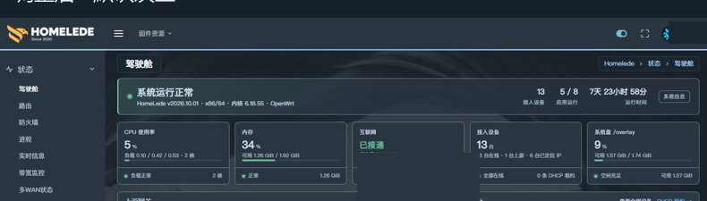
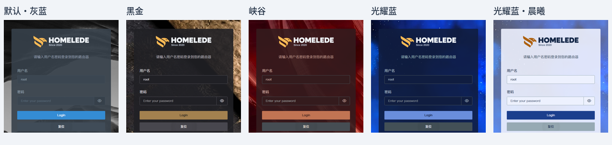

# InfinityFreedom-NG · ucode

[English](README.md) · [HomeLede](https://github.com/xiaoqingfengATGH/HomeLede) · [问题反馈](https://github.com/xiaoqingfengATGH/luci-theme-infinityfreedom/issues) · [交流社区](https://t.me/t_homelede)

[](LICENSE)

**面向 HomeLede 与现代 OpenWrt 的响应式 LuCI 主题，基于 ucode 模板重构。**

默认的 `ucode` 分支不只是更换模板引擎：它同时带来了五套配色、可定制导航、更新后的登录与品牌界面，以及与 HomeStatus 家庭驾驶舱的协作。布局适配电脑、平板和手机。

## 新版有哪些变化

- **适应 LuCI 新架构。** 使用服务端 `.ut` 模板替代旧版主题模板实现，面向 OpenWrt 24.10/26.x 所使用的 ucode LuCI 架构，不再沿用旧 README 的“兼容 LuCI 18”说明。
- **五套完整配色。** 默认·灰蓝、黑金、峡谷、光耀蓝、光耀蓝·晨曦。晨曦为独立浅色方案，不是简单替换背景；配色覆盖导航、表单、表格、弹窗、状态语义色及交互状态。
- **在界面中切换配色。** 从用户菜单选择配色，无需重新编译固件；选择保存到 UCI，登录页与管理界面使用同一配色设置。
- **可定制侧栏菜单。** 通过 `/etc/config/infinityfreedom-ng` 调整顺序、修改显示名称、建立分组、设置分组图标，以及把已有菜单移到其他组。移动后保留页面原 URL；未安装应用不会生成空菜单。
- **配套 HomeStatus 驾驶舱。** 驾驶舱主体 JS/CSS 已迁至独立的 `luci-app-homestatus`。主题负责外壳、加载协作和配色适配；存储视图、应用状态、网络唤醒等功能由配套应用提供。
- **更新品牌与登录体验。** HomeLede 品牌素材适配深浅承载面以及展开、收缩导航；登录页支持密码显隐，并接入 LuCI 标准翻译流程。
- **英文与简体中文。** 主题自身文案使用英文源字符串和简体中文翻译目录；各应用仍使用自己的翻译资源。

## 兼容范围与依赖

| 项目 | 要求或范围 |
| --- | --- |
| LuCI | ucode 架构；源码面向 OpenWrt 24.10/26.x |
| 必需软件包 | `luci-base`、`luci-app-homestatus` |
| HomeStatus 最低版本 | 软件包元数据声明为 `>= 1.0.0-r2` |
| 构建输入 | 配套应用的 `htdocs/luci-static/resources/view/homestatus/overview.css`，供配色生成器使用 |
| 中文界面 | `luci-i18n-base-zh-cn`、`luci-i18n-infinityfreedom-ng-zh-cn` |

HomeLede 是主要集成环境。在其他 OpenWrt 固件中使用时，需要配套 Feed 与兼容的 LuCI 组件；这不代表已验证所有版本、分支和第三方应用。安装主题不会自动安装 HomeLede 菜单或截图中的全部应用。在当前分支，HomeStatus 是必需依赖，不是可选的驾驶舱插件。

## 添加到 OpenWrt 构建环境

以下命令在已配置好的 OpenWrt 构建根目录执行。编辑 `feeds.conf.default` 或实际使用的 Feed 配置，添加下面两行；如果已有配套 Feed，请勿重复添加：

```text
src-git infinityfreedomng https://github.com/xiaoqingfengATGH/luci-theme-infinityfreedom.git;ucode
src-git xiaoqingfeng https://github.com/xiaoqingfengATGH/feeds-xiaoqingfeng.git;master
```

先安装两个软件包的 Feed 链接，再编译主题：

```sh
./scripts/feeds update infinityfreedomng xiaoqingfeng
./scripts/feeds install luci-app-homestatus
./scripts/feeds install luci-theme-infinityfreedom-ng
make menuconfig
```

在 **LuCI → Themes** 中选择 **luci-theme-infinityfreedom-ng**。中文固件需启用 `CONFIG_LUCI_LANG_zh_Hans=y`，执行 `make defconfig` 后确认基础中文包和主题中文包均已选中。

之后正常构建固件，也可以单独编译主题目标：

```sh
make package/feeds/infinityfreedomng/luci-theme-infinityfreedom-ng/compile V=s
```

产物位于 `bin/packages/<架构>/<feed>/` 下，具体格式和路径随目标构建系统变化。单独编译主题不代表可以省略配套应用：部署时仍需包含或构建 HomeStatus。以上为源码集成方法，不表示已在所有目标上重新执行 SDK 构建。

如果配色准备阶段提示找不到 HomeStatus 样式，先检查 `package/feeds/*/luci-app-homestatus` 的已安装链接。自定义源码布局可以显式传入真实的绝对路径：

```sh
make package/feeds/infinityfreedomng/luci-theme-infinityfreedom-ng/compile V=s \
  HOMESTATUS_OVERVIEW_CSS=/absolute/path/to/luci-app-homestatus/htdocs/luci-static/resources/view/homestatus/overview.css
```

## 启用与个性化

1. 打开 LuCI 的 **系统 → 系统 → 语言和界面**，HomeLede 中菜单显示名可能经过定制。
2. 主题选择 **infinityfreedomNG**，保存并应用后刷新页面。
3. 在用户菜单中打开 **配色**，选择所需方案。

| UCI 标识 | 配色 |
| --- | --- |
| `default` | 默认·灰蓝 |
| `blackgold` | 黑金 |
| `canyon` | 峡谷 |
| `luminousblue` | 光耀蓝 |
| `luminousblue-light` | 光耀蓝·晨曦 |

也可以通过命令行设置：

```sh
uci set infinityfreedom-ng.palette.name='luminousblue-light'
uci commit infinityfreedom-ng
```

随后刷新页面。`default` 是配色标识，并不保证是固件初始选择：当前仓库随包配置选择 `luminousblue-light`，模板回退值则为 `default`。已有设备也可能保留自己的选择。

菜单定制请参考 [UCI 配置中的注释与示例](luci-theme-infinityfreedom-ng/root/etc/config/infinityfreedom-ng)。菜单调整只影响显示组织，不等于安装应用，也不改变访问权限。

## 界面截图

### 驾驶舱 · 默认灰蓝



### 五套登录配色



## 开发与反馈

- [主题翻译与校验说明](luci-theme-infinityfreedom-ng/docs/i18n.md)
- [HomeStatus 迁移与构建配套说明](luci-theme-infinityfreedom-ng/README-homestatus-phase1.md)：属于技术迁移记录，历史测试结果不代表当前版本的全面验收。
- [配色源文件](luci-theme-infinityfreedom-ng/scripts/palettes/)与[生成器](luci-theme-infinityfreedom-ng/scripts/gen-palettes.py)
- [HomeStatus 配套 Feed](https://github.com/xiaoqingfengATGH/feeds-xiaoqingfeng/tree/master/luci-app-homestatus)

反馈时请提供固件与 LuCI 版本、主题和 HomeStatus 软件包版本、配色、出问题的页面、屏幕尺寸及复现步骤。截图和日志请去除凭据、公网 IP、MAC 地址和私人主机名。

## 许可证

[Apache License 2.0](LICENSE)。已有版权声明和第三方资源声明继续适用。
